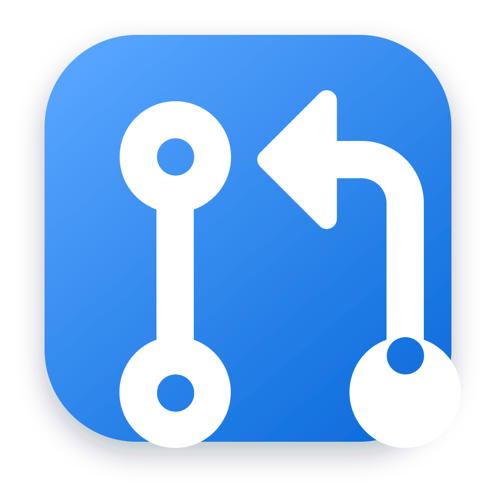
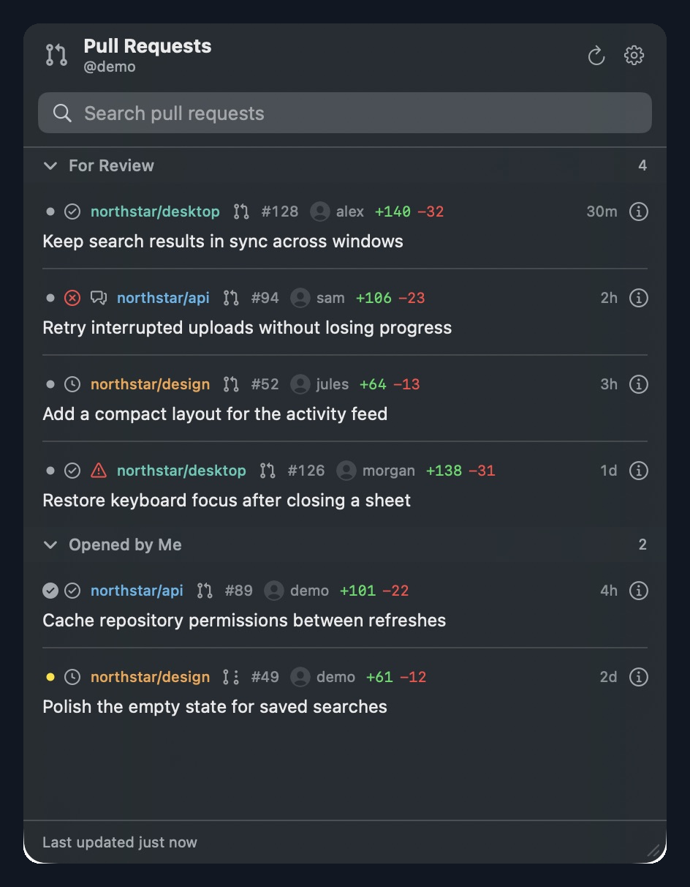
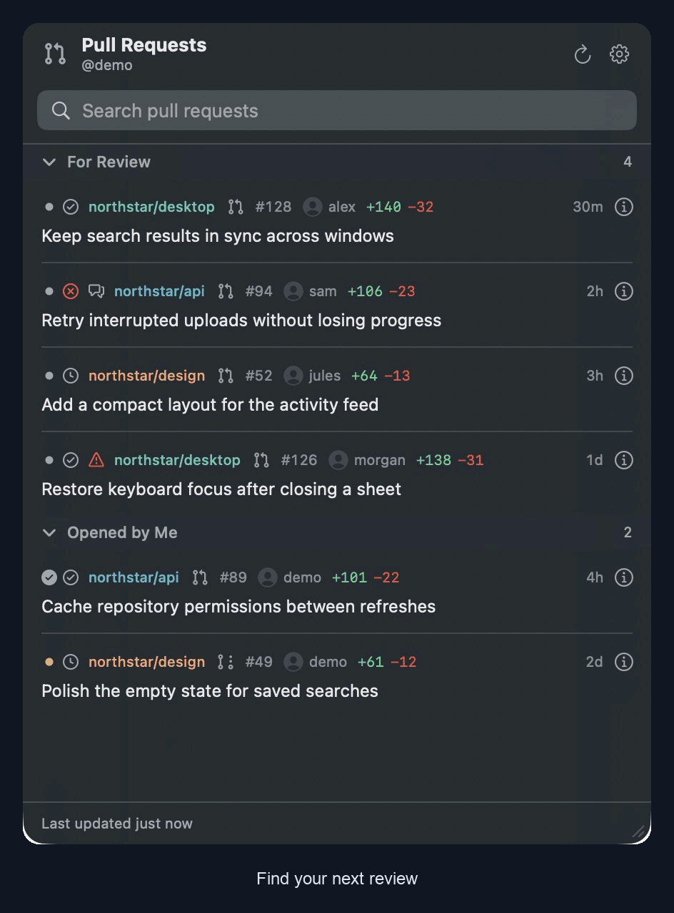
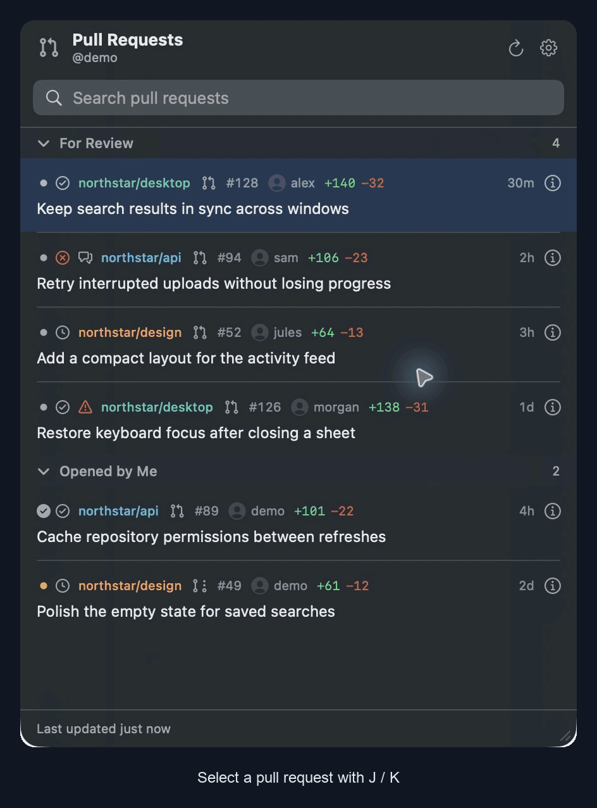
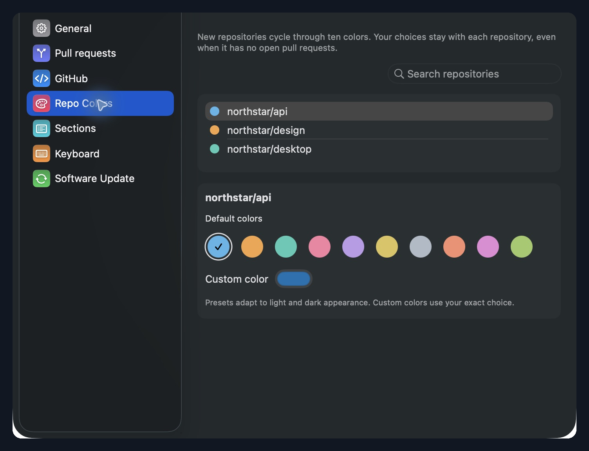

  

<h1 align="center">Glance</h1>

<strong>Your pull requests. Your next move. One glance.</strong>

  A native macOS menu-bar app that keeps GitHub reviews and pull requests close at hand.

  <a href="https://github.com/atchad/glance/releases/latest/download/Glance.dmg">Download for Mac</a> ·
  <a href="#get-started">Get started</a> ·
  <a href="docs/USAGE.md">User guide</a>

  

## Know what needs you

A review request, a failed build, a new commit after your approval—Glance brings the signals together so you can decide what to tackle next. See reviews, checks, conflicts, and merge readiness without working through a pile of browser tabs.

Open the menu-bar popover for a quick look, or bring up the resizable floating panel to keep your queue beside your work.

## Turn a queue into a plan

Search across your pull requests, pin the ones that matter, and snooze the ones that can wait. Dismiss a revision you’ve dealt with; it returns when a new commit arrives. Keyboard navigation keeps everyday triage quick.

  

Full titles and fetched check details are a click away. Open a pull request when you’re ready to review it, or use Glance’s optional built-in GitHub windows to keep discussions and unfinished comments around between visits during the session.

  

## A queue that fits your work

Start with reviews requested from you and pull requests you opened. Add your own sections with GitHub search queries, choose the repositories you care about, and give them recognizable colors. Optional notifications bring you back when a review arrives or a pull request’s status changes.

  

All screenshots and animations use fictional demo data on a neutral backdrop.

## Get started

You’ll need **macOS 14 or later** and [GitHub CLI](https://cli.github.com/) connected to your GitHub account. Glance currently supports **github.com**.

1. Install GitHub CLI with `brew install gh`, or follow its [installation guide](https://cli.github.com/).
2. Sign in with `gh auth login --hostname github.com`.
3. [Download Glance](https://github.com/atchad/glance/releases/latest/download/Glance.dmg), open the DMG, and drag the app into Applications.
4. Launch Glance and open it from your menu bar.

Glance supports Apple silicon and Intel Macs. Releases are Developer ID signed and notarized by Apple.

## Local by design

Glance uses your existing GitHub CLI authentication and stores preferences and pull-request metadata locally. It does not persist the CLI token itself. The optional built-in browser connects directly to GitHub and keeps its own website cookies and storage. See the [privacy and local-data guide](docs/USAGE.md#privacy-and-local-data) for details.

## Learn more & contribute

- [User guide](docs/USAGE.md) — settings, status indicators, merge actions, and troubleshooting.
- [Keyboard reference](docs/KEYBINDINGS.md) — shortcuts and custom bindings.
- [Contributing](CONTRIBUTING.md) — build from source, testing, and pull requests.
- [Security](SECURITY.md) — report a vulnerability privately.

Glance is open source under the [MIT License](LICENSE). Built with [Primer Octicons](https://github.com/primer/octicons) and [Sparkle](https://sparkle-project.org/); their licenses are included with the app.
